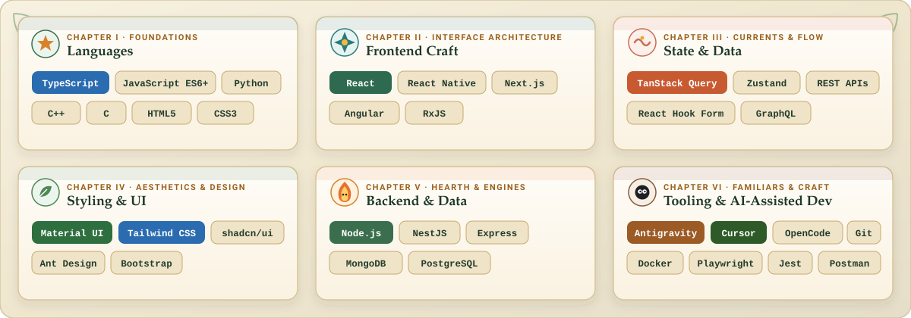

<!-- ☀️ / 🌙 ADAPTIVE STUDIO GHIBLI HERO PANORAMA -->
<picture>
  <source media="(prefers-color-scheme: dark)" srcset="./assets/hero-dark.svg" />
  <source media="(prefers-color-scheme: light)" srcset="./assets/hero-light.svg" />
  
</picture>

 

<!-- 🧭 GHIBLI-HARMONIZED STATUS & GUILD PILLS -->

<picture>
  <source media="(prefers-color-scheme: dark)" srcset="./assets/divider-dark.svg" />
  <source media="(prefers-color-scheme: light)" srcset="./assets/divider-light.svg" />
  
</picture>

## ✨ The Craftsman's Grimoire · Tech Arsenal

  <picture>
    <source media="(prefers-color-scheme: dark)" srcset="./assets/tech-arsenal-dark.svg" />
    <source media="(prefers-color-scheme: light)" srcset="./assets/tech-arsenal-light.svg" />
    
  </picture>

📜 <b>Open Full Interactive Spellbook (Text &amp; Badge Index)</b>

 

<table>
  <tr>
    <td valign="top" width="50%">

**🌿 Languages**

</td>
    <td valign="top" width="50%">

**🎐 Frontend Craft**

</td>
  </tr>
  <tr>
    <td valign="top">

**🌊 State & Data Streams**

</td>
    <td valign="top">

**🎨 Styling & UI**

</td>
  </tr>
  <tr>
    <td valign="top">

**🔥 Backend & Persistence**

</td>
    <td valign="top">

**🧭 Tooling & AI Spirits**

</td>
  </tr>
</table>

<picture>
  <source media="(prefers-color-scheme: dark)" srcset="./assets/divider-dark.svg" />
  <source media="(prefers-color-scheme: light)" srcset="./assets/divider-light.svg" />
  
</picture>

## 🏮 Guild Chronicles · What I've Been Building

<b>🏰 Software Engineer · SELISE Digital Platforms</b> &nbsp;·&nbsp; Mar 2023 — Present

 

<table>
  <tr>
    <td>
      <b>🎐 <code>RIQS</code></b> &nbsp;
      
      
      
      
      <ul>
        <li>Migrated legacy Angular components and complex workflows to React with TypeScript, custom hooks, and modern component architecture.</li>
        <li>Used AI agents to automate repetitive migration work, draft implementation plans, and surface hidden dependencies — pulling the delivery timeline in.</li>
        <li>Reviewed and refactored AI-generated code so quality, render performance, and engineering standards held up before merge.</li>
        <li>Partnered closely with fellow engineers to debug migration edge cases and validate end-to-end behaviour across the platform.</li>
      </ul>
    </td>
  </tr>
  <tr>
    <td>
      <b>🔥 <code>EagleGPT</code></b> &nbsp;
      
      
      
      
      <ul>
        <li>Built a responsive AI chat workspace that stays silky-smooth across long threads and high-frequency token streaming.</li>
        <li>Tuned component rendering and granular state updates to keep the UI responsive under heavy conversation load.</li>
        <li>Implemented resilient client-side data fetching, caching, and state synchronization over REST.</li>
        <li>Shipped user-facing features alongside designers, backend engineers, the LLM team, and product.</li>
      </ul>
    </td>
  </tr>
  <tr>
    <td>
      <b>🌿 <code>CLM — Construction Management System</code></b> &nbsp;
      
      
      
      <ul>
        <li>Built reusable, modular UI components that raised maintainability and accelerated delivery across the team.</li>
        <li>Integrated REST and GraphQL APIs with reactive client-side fetching and state management.</li>
        <li>Diagnosed and resolved complex frontend issues across both production and development environments.</li>
      </ul>
    </td>
  </tr>
</table>

<b>🌱 Frontend Developer Intern · iBOS</b> &nbsp;·&nbsp; Oct 2022 — Feb 2023

 

<table>
  <tr>
    <td>
      <b>🍃 <code>Managerium</code></b> &nbsp;
      
      
      <ul>
        <li>Developed responsive, intuitive interfaces with HTML, CSS, JavaScript, and React.</li>
        <li>Translated UI/UX specifications into reusable, accessible component libraries.</li>
        <li>Integrated frontend views with REST APIs to render dynamic business data.</li>
        <li>Collaborated with senior developers to ship new modules and refine existing workflows.</li>
      </ul>
    </td>
  </tr>
</table>

<picture>
  <source media="(prefers-color-scheme: dark)" srcset="./assets/divider-dark.svg" />
  <source media="(prefers-color-scheme: light)" srcset="./assets/divider-light.svg" />
  
</picture>

## 🐉 Spirit of the Forest · Contribution Trail

  <picture>
    <source media="(prefers-color-scheme: dark)" srcset="https://raw.githubusercontent.com/hrz07/hrz07/output/github-snake-dark.svg" />
    <source media="(prefers-color-scheme: light)" srcset="https://raw.githubusercontent.com/hrz07/hrz07/output/github-snake.svg" />
    
  </picture>

 

## 🕊️ Send a Messenger Bird · Let's Connect

&nbsp;

&nbsp;

  

<picture>
  <source media="(prefers-color-scheme: dark)" srcset="./assets/footer-dark.svg" />
  <source media="(prefers-color-scheme: light)" srcset="./assets/footer-light.svg" />
  
</picture>

